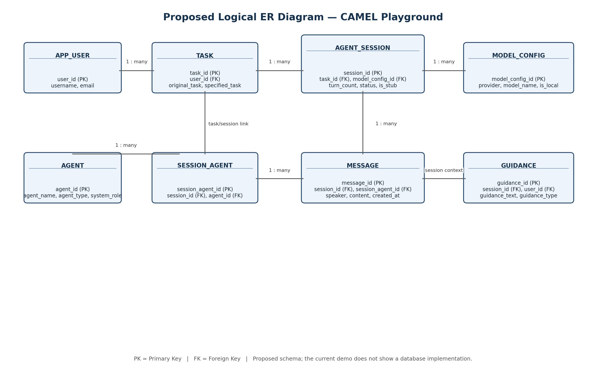
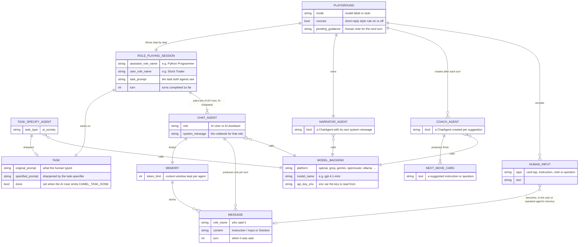

# SENG 691 – Group 3 – CAMEL Multi-Agent Framework (Phases 1 and 2)

Phase 1 deliverable: the CAMEL agent framework built and deployed in a working
environment, with a reproducible demo of its main behaviour (two LLM agents
role-playing to solve a task). Group submission due **Tuesday, Oct 27, 2026,
11:59 PM EDT**.

Phase 2 (due **Sunday, Nov 15, 2026, 11:59 PM EST**) implements the three
enhancements the Phase 1 future plan proposed: persistent sessions, progress
monitoring with run controls, and model configuration with preflight checks
and automatic retry. See **Phase 2 enhancements** below for what was built,
how it is verified, and how to run the tests and benchmarks. The hosted
Playground and the `main` branch of this repository now run the Phase 2 build.

This repository contains **our setup, demo scripts and notes**. The upstream
CAMEL source is included as a git submodule pinned to an exact commit, so the
team can read the framework code for the report without us copying 2,000+
upstream files into our own history.

## Try it live

**Hosted Playground: https://camel-playground.onrender.com** (login name
`group3`; the password is shared with the team and the course staff). Type any
task, press Start, and watch two CAMEL agents work on it, or take the
instruction seat yourself. It runs on Render's free plan, so the first visit
after a quiet period takes up to a minute to wake.

**Demo video (Phase 1):** https://drive.google.com/file/d/1jsQBaKJzxOgjVpOkQbZcRezwolk6Fwi-/view
(Google Drive) walks through the notebook run and the Playground.

**Phase 2 demo video:** a narrated walkthrough of the three enhancements
running in the app's offline test mode, submitted with the Phase 2 report
through Blackboard.

No account needed to read the demo: the notebook
[demo/role_playing_demo.ipynb](demo/role_playing_demo.ipynb) is committed with
the outputs of a real 5-turn run, or
[open it in Colab](https://colab.research.google.com/github/jamelski1/camel/blob/main/demo/role_playing_demo.ipynb)
to run it with your own key.

## Phase 2 enhancements

Phase 2 keeps the Phase 1 Playground and adds the three enhancements from the
Phase 1 future plan. All three live in `demo/` next to `playground.py`, and
Phase 2 added **no new third-party dependencies** (the session store uses
SQLite from the Python standard library).

**1. Persistent sessions** (`demo/session_store.py`). In Phase 1 a session
lived only in the app's memory; a restart lost the task, the roles, the
transcript and the settings. Now every session is written through to a SQLite
database as it runs, with three tables (`sessions`, `messages`, `guidance`)
taken from the Phase 1 design. The sidebar lists saved sessions; selecting one
and pressing **Open selected** restores all ten setup fields and the full
transcript exactly, rebuilds the agents' memories from that transcript, and
lets the conversation continue. **Delete selected** removes a session with its
messages and guidance. Sessions are stored in `data/sessions.db` (set
`PLAYGROUND_DB` to use a different path).

**2. Progress monitoring and run controls** (`demo/progress_monitor.py`). The
CAMEL paper catalogues how agent conversations break down (repetition, loops,
flake replies); the paper prevents them by prompt design, but nothing detects
them during a run. Our monitor is a small deterministic checker, not another
model call: after every turn it flags repetition (a message 80% similar to one
the same agent sent recently), stalls (two turns adding almost no new words),
drift (exchanges that barely mention the task's keywords) and possible
completion. Flags appear in the chat as Narrator "Progress check:" lines and
are counted in the status strip. Run controls: **AI User: run all turns** is
the main autonomous control; the turn limit is 12 by default and adjustable
from 4 to 40; **Pause** and **Resume** hold and continue a run; and **agent
mode** at setup runs the whole session with no human input.

**3. Model configuration, preflight and retry** (`demo/model_config.py`).
In Phase 1 a setup mistake (a missing key, a mistyped model name) only
surfaced after Start, when the first model call failed mid-run. A preflight
check now validates the setup first: the provider is known, the model name
resolves, the API key is present, and the model object can be constructed.
When a call fails during a run, the error is classified (rate limit, rejected
key, unknown model, timeout, connection problem, unrecognized), each category
carries one line of plain guidance, and the temporary categories are retried
up to three attempts with backoff (0.5 s, then 1 s) while permanent errors
fail at once. The Playground's provider dropdown offers only **OpenAI** and
**OpenRouter**, the two providers implemented and tested end to end in the
app.

**Verification (all offline, no API key needed).**
`demo/test_phase2.py` runs 19 end-to-end checks of the three enhancements and
all pass. `demo/benchmark_phase2.py` reports: monitor accuracy on 15
hand-labelled transcripts (all 11 planted flags caught on the exact labelled
turn, no false positives; precision, recall and F1 all 1.00 on this small
suite, which shows the detector implements its stated rules rather than that
the thresholds are optimal); persistence at scale (50 sessions of 40 messages
each, 2,000 messages, saved and reopened cold with every field and message
exact, reopening in about 0.1 ms per session); and error handling (12 of 12
sample provider errors classified correctly). Code metrics across the six
implementation files: measured code lines grew from 689 (Phase 1) to 1,405,
while Lizard's average cyclomatic complexity per function fell from 6.7 to
5.4, because the new behaviour lives in three small focused modules.

**Known limitations.** On the hosted copy, Render's free plan has an
ephemeral filesystem, so saved sessions there are wiped whenever the service
restarts or redeploys, and the saved list is shared by everyone who opens the
hosted site; run locally, the database persists. The two conversation agents
are built with no tools, so they can only talk; wiring a CAMEL toolkit into
the agents is a Phase 3 candidate, as are a visual workflow view and a
dashboard for comparing sessions and models.

## What CAMEL is (one paragraph for the report)

CAMEL ("Communicative Agents for 'Mind' Exploration of Large Language Model
Society") is an open-source framework for building societies of
LLM-powered agents that talk to each other to complete a task. Its core idea,
*role-playing*, pairs an **AI User** agent (plays the human asking for
something, e.g. a "Stock Trader") with an **AI Assistant** agent (e.g. a
"Python Programmer"). A third **task-specifier** agent first rewrites a vague
task into a concrete one, then the two agents take turns until the user agent
emits `CAMEL_TASK_DONE`. Analogy: a client and a contractor on a phone call,
with a project manager who first clarifies the brief; each party has a script
("system message") describing its role, and the framework passes the call
back and forth. The method is from Li et al., *CAMEL: Communicative Agents for
"Mind" Exploration of Large Language Model Society*, NeurIPS 2023
(arXiv:2303.17760). Code: https://github.com/camel-ai/camel, docs:
https://docs.camel-ai.org.

## Report, ER diagram and future plan

The written Phase 1 deliverables live in `docs/`:

- **[CAMEL_Technical_Report.docx](docs/CAMEL_Technical_Report.docx)**: how the
  system works, code and technology analysis, demonstration and evaluation,
  lessons learned, references.
- **[CAMEL_Playground_ER_Diagram_and_Future_Plan.docx](docs/CAMEL_Playground_ER_Diagram_and_Future_Plan.docx)**:
  the proposed **persistent data model** for a future version of the Playground
  (users, tasks, agent sessions, model configurations, messages, guidance) with
  the ER diagram below as a figure, followed by the phased future development plan.



This is the project's ER diagram as proposed in Phase 1, when the demo kept
everything in memory and had no database. Phase 2 implemented its core:
sessions, messages and guidance are now stored in SQLite by
`demo/session_store.py`, and the Phase 2 report carries the revised diagram
for the schema as implemented. The next section shows the same system from
the other side, the objects that exist at runtime today, and ends with a
table mapping one onto the other.

## How the pieces fit together (runtime object diagram)

Everything below lives in memory for one run. This diagram describes the
runtime objects and how they relate, in the same box-and-line notation as the
ER diagram above so the two can be read together. Boxes from `ROLE_PLAYING_SESSION`
down to `MESSAGE` are upstream CAMEL; `PLAYGROUND`, `NARRATOR_AGENT`,
`COACH_AGENT`, `NEXT_MOVE_CARD` and `HUMAN_INPUT` are our additions in
`demo/playground.py`. GitHub renders the diagram; the source is plain Mermaid.



Reading the diagram: one session owns one task and exactly two `ChatAgent`s.
Each agent has its own memory of messages and its own system message, but in
our setup all agents share one model backend, chosen per team member through
`.env`. The task-specifier runs once, before the session, and may rewrite the
task. The Playground wraps the session: after every turn a coach agent
proposes three cards, a narrator agent summarises bursts, and anything the
human types is written into an agent's memory as a message so the agents stay
coherent. Upstream CAMEL also supports an optional critic agent and task
planner (fields on `RolePlaying`); we do not use them, so they are omitted.

How the runtime objects map onto the proposed schema in
`docs/CAMEL_Playground_ER_Diagram_and_Future_Plan.docx`:

| Runtime object (this diagram) | Proposed table (ER diagram above) | Note |
|---|---|---|
| `ROLE_PLAYING_SESSION` | `AGENT_SESSION` | one row per run; `turn_count`, `status` and `is_stub` are the session's `turn`, `done` and mode |
| `TASK` | `TASK` | `original_task` / `specified_task` are the same two fields |
| `CHAT_AGENT` | `AGENT` + `SESSION_AGENT` | the schema splits the reusable role (`AGENT`) from its use in one session (`SESSION_AGENT`) |
| `MESSAGE` | `MESSAGE` | `speaker` is the `session_agent_id`; `created_at` replaces the turn number |
| `MODEL_BACKEND` | `MODEL_CONFIG` | `provider`, `model_name`, `is_local` (Ollama) |
| `HUMAN_INPUT` | `GUIDANCE` | `guidance_type` is our card tap / instruction / note / question |
| `NARRATOR_AGENT`, `COACH_AGENT`, `NEXT_MOVE_CARD` | not stored | derived from the messages each time, so they need no table |
| none | `APP_USER` | the Playground has no accounts yet; this is the future-plan part |
| `MEMORY` | none | an in-process cache of `MESSAGE` rows; the table replaces it |

## Repository layout

```
.
├── README.md                 <- this file
├── setup.sh                  <- one-shot reproduction of the environment (Linux/macOS)
├── setup.ps1                 <- same steps for Windows PowerShell
├── .env.example              <- API key template (copy to .env, never commit .env)
├── .gitignore                <- excludes .env, .venv, caches
├── .gitmodules               <- pins upstream CAMEL as a submodule
├── requirements.txt          <- plain-pip alternative to setup.sh (CAMEL from PyPI, same version)
├── requirements-render.txt   <- dependencies of the hosted Playground
├── render.yaml               <- Render.com blueprint for the hosted Playground
├── camel/                    <- upstream CAMEL source (submodule, unmodified)
├── demo/
│   ├── check_env.py          <- verifies Python, CAMEL import, key presence
│   ├── role_playing_demo.py  <- the Phase 1 demo (adapted upstream example)
│   ├── role_playing_demo.ipynb <- same demo as a notebook, with a saved real run, plus the Playground
│   ├── playground.py         <- interactive web UI: any task, saved sessions, run controls, narrator, human feedback
│   ├── session_store.py      <- Phase 2: SQLite write-through store (sessions, messages, guidance)
│   ├── progress_monitor.py   <- Phase 2: deterministic repetition / stall / drift / completion checks
│   ├── model_config.py       <- Phase 2: preflight checks, error classification, retry with backoff
│   ├── test_phase2.py        <- Phase 2: offline verification suite (19 checks)
│   └── benchmark_phase2.py   <- Phase 2: offline benchmarks (monitor accuracy, persistence, error handling)
├── data/                     <- created at runtime: sessions.db, the Phase 2 session store (not committed)
└── docs/
    ├── CAMEL_Technical_Report.docx                      <- Phase 1 technical report
    ├── CAMEL_Playground_ER_Diagram_and_Future_Plan.docx <- proposed data model and future plan
    ├── er_diagram_proposed.png                          <- the ER diagram from that document
    ├── SETUP_NOTES.md        <- every command run, every error, every fix
    └── demo_output/          <- captured logs proving what ran
```

## Versions installed

| Component | Version | Where |
|---|---|---|
| Python | 3.10.20 (uv-managed CPython) | `.venv/` (project root) |
| CAMEL (`camel-ai`) | 0.2.91a7, installed **from source, editable** | `camel/` submodule, upstream commit `797296a` |
| uv (installer) | 0.11.32 | system |
| openai SDK | 2.54.0 | `.venv/` |

Python note: CAMEL declares `requires-python >=3.10,<3.15`, but every upstream
CI workflow runs 3.10. The machine's default interpreter was 3.13.17 (3.11 and
3.12 also present, 3.10 absent). 3.13 is inside the supported range, but to
match upstream's tested configuration we installed 3.10 with `uv`.

## Setup (reproduce from a fresh clone)

Quick path:

```bash
git clone --recurse-submodules https://github.com/jamelski1/camel.git
cd camel
./setup.sh
```

Manual path (exactly what `setup.sh` does; these are the commands we ran):

```bash
git submodule update --init --depth 1 camel      # fetch upstream CAMEL source
uv python install 3.10                           # CAMEL CI's Python
uv venv --python 3.10 .venv                      # isolated environment
uv pip install --python .venv/bin/python -e ./camel   # CAMEL from source (editable)
```

Fallback if the source install fails on your machine:
`uv pip install --python .venv/bin/python camel-ai` (PyPI wheel; we did **not**
need this, the source install succeeded first try).

Without `uv`: `python3.10 -m venv .venv && .venv/bin/pip install -e ./camel`.
Without the submodule at all: `pip install -r requirements.txt` installs the
same CAMEL version from PyPI, plus Gradio and Jupyter for the Playground and
the notebook.

Windows (PowerShell): run `.\setup.ps1`, or the same commands with the venv
interpreter at `.venv\Scripts\python.exe` instead of `.venv/bin/python`.

## Activate the environment

```bash
source .venv/bin/activate        # Linux / macOS
# .venv\Scripts\activate         # Windows PowerShell
python demo/check_env.py         # should print CAMEL 0.2.91a7 on Python 3.10.20
```

## API key (required for any real LLM run)

```bash
cp .env.example .env
# edit .env and set OPENAI_API_KEY=sk-...   (your own key, from platform.openai.com)
```

* `.env` is in `.gitignore`. **Never commit, paste, or screenshot a real key.**
* The demo reads the key with `python-dotenv`; CAMEL's `ModelFactory` also
  reads `OPENAI_API_KEY` from the environment directly, so a key already set
  as an environment variable works without a `.env` file (that is how the
  Windows run in log 07 was done).
* Default model is `gpt-4.1-mini-2025-04-14` on OpenAI. See the next section
  to use a different provider or model.

## Using a different model or provider (per team member)

CAMEL is not tied to OpenAI. The demo script and notebook accept any model
backend CAMEL supports, and each team member can pick their own without
touching code: put two lines in your private `.env`.

```
MODEL_PLATFORM=groq                 # openai (default), groq, gemini, openrouter, cerebras, anthropic, ollama, ...
MODEL_NAME=llama-3.3-70b-versatile  # optional; each platform has a sensible default
GROQ_API_KEY=...                    # the key for *that* platform
```

The same choice can be made per run with `--platform` / `--model` on the
script, or with `PLATFORM` / `MODEL` in the notebook's settings cell
(precedence: flag or cell > `.env` > default). `--list-platforms` prints
every platform name CAMEL knows.

Phase 2 note: the Playground's own provider dropdown offers only `openai`
and `openrouter`, the two providers implemented and tested end to end in the
app. The demo script and notebook still accept the other CAMEL backends in
the table below.

| Platform | Key variable | Default model here | Cost |
|---|---|---|---|
| `openai` | `OPENAI_API_KEY` | `gpt-4.1-mini-2025-04-14` | paid |
| `groq` | `GROQ_API_KEY` | `openai/gpt-oss-120b` | free tier (Groq retired its Llama 3.x models on 2026-08-16) |
| `gemini` | `GEMINI_API_KEY` | `gemini-2.5-flash` | free tier |
| `cerebras` | `CEREBRAS_API_KEY` | `gpt-oss-120b` | $5 trial credits that expire after 30 days; no permanent free tier |
| `openrouter` | `OPENROUTER_API_KEY` | `openrouter/free` (auto-routes to a free model) | free models, 50 requests/day until $10 of credit is bought, then 1,000/day |
| `anthropic` | `ANTHROPIC_API_KEY` | `claude-sonnet-4-5` | paid |
| `ollama` | none (local server) | `llama3.1:8b` | free, runs on your machine; not on Colab |

In the notebook, if none of this is preset, the imports cell asks: a numbered
menu of providers, then a model name only for providers without a default,
then the key in a hidden box. Nothing typed into those prompts is saved in the
notebook.

### Free-tier limits and what the Playground costs per click

Checked against the providers' own pages on 2026-10-24 (they change often):

| Provider | Free limit | Source |
|---|---|---|
| OpenRouter `:free` models | 20 requests/min; **50 requests/day** with under $10 of credit ever bought, **1,000/day** once $10 has been bought (the credit itself is not consumed by free models) | openrouter.ai/docs/api-reference/limits |
| Groq | Free plan numbers are behind a login; the published table shows 30 requests/min, 1,000/day, 8K tokens/min for `openai/gpt-oss-120b` | console.groq.com/docs/rate-limits |
| Google Gemini | 2.5 Flash and Flash-Lite are "free of charge"; per-model request limits are shown only inside AI Studio after login | ai.google.dev/gemini-api/docs/pricing |
| Cerebras | No permanent free tier: $5 of trial credit that expires after 30 days | inference-docs.cerebras.ai/support/rate-limits |

Playground calls per action: Start = 3 (roles, task-specifier, cards); tap a
card or send an instruction = 2 (assistant, new cards); "AI User: run all
turns" costs about 2 agent calls per turn, plus the Narrator summary and
fresh cards after each turn. A ten-minute
session is therefore 30 to 50 calls, which is why OpenRouter's 50/day cap is
hit in one sitting. Options, in order of least hassle:

1. Stay on OpenRouter and buy $10 of credit once: the free models then allow
   1,000 requests/day, and the credit also lets `MODEL_NAME` fall back to a
   cheap paid model. No change to the repo or Render.
2. Switch to Groq (`MODEL_PLATFORM=groq`, `GROQ_API_KEY`): no card, about
   1,000 requests/day, but a low tokens-per-minute cap may slow 3-turn bursts.
3. Gemini (`MODEL_PLATFORM=gemini`, `GEMINI_API_KEY`): free, limits visible
   only in AI Studio.

When a limit is hit the Playground now says so in plain words (wait a minute,
or switch provider under Advanced) instead of showing a raw error.

Notes: only the OpenAI path has been run end to end by us (logs 07 and the
notebook); the others are wired through CAMEL's own backends and verified to
fail cleanly when their key is missing. The platforms in the table need no
extra packages; a few others (for example `mistral`, `aws-bedrock`) need
their own SDK, and the script and notebook say which package when that
happens. Smaller open models follow CAMEL's
role rules less strictly than gpt-4.1-mini, so the AI User may drift from the
`Instruction:` / `Input:` format. Default model names are current as of
2026-10-24 and may need updating if a provider retires one.

## Run the demo

```bash
source .venv/bin/activate
python demo/role_playing_demo.py --turns 5        # real LLM run (needs key)
python demo/role_playing_demo.py --stub           # offline smoke test, no key
python camel/examples/ai_society/role_playing.py  # the unmodified upstream example
```

### Notebook version (easiest way to run and read the demo)

`demo/role_playing_demo.ipynb` mirrors the Playground: a short settings cell,
a setup cell, then **Quick start** (the Playground app opens under the cell)
and a **Walkthrough** that drives the same `Playground` class one step at a
time on a fixed task: sharpened goal, collapsed rulebooks, the turns with one
heading per instruction, then the Narrator's summary. It is committed **with
the outputs of a real 5-turn walkthrough** so it can be read on GitHub
without running anything.

```bash
uv pip install --python .venv/bin/python notebook     # one-time; Windows: .venv\Scripts\python.exe
.venv/bin/jupyter notebook demo/role_playing_demo.ipynb   # Windows: .venv\Scripts\jupyter.exe
```

Pick the venv's Python as the kernel, edit the settings cell, then Run All.
Set `STUB = True` to run offline without a key. To regenerate the saved
outputs from the command line:

**Google Colab (no local setup at all):**
[Open in Colab](https://colab.research.google.com/github/jamelski1/camel/blob/main/demo/role_playing_demo.ipynb),
or upload the notebook by hand (File > Upload notebook). Add your key in the
Secrets panel (key icon, left sidebar) as a secret named `OPENAI_API_KEY`
with notebook access on, then Runtime > Run all.
The setup cell detects that CAMEL is missing and installs `camel-ai==0.2.91a7`
from PyPI, the same version as the pinned submodule. Without a Colab secret
the notebook asks for the key with a hidden prompt; it is never printed or
saved into the notebook.

```bash
.venv/bin/python -m nbconvert --to notebook --execute --inplace demo/role_playing_demo.ipynb
```

### Playground: an interactive UI for any task

`demo/playground.py` is a small web app (Gradio) on top of the same CAMEL
machinery, for people who want to *play* with the agents rather than read a
script. It is the last cell of the notebook (renders inline on Colab) and also
runs standalone:

```bash
uv pip install --python .venv/bin/python gradio      # one-time; Windows: .venv\Scripts\python.exe
.venv/bin/python demo/playground.py                 # opens http://127.0.0.1:7860 in your browser
.venv/bin/python demo/playground.py --stub          # click around offline, no key
```

How it works, in two screens:

1. **One box, one button.** Type any task and press Start. A model names the
   two roles for you; roles, provider, model and the offline test mode live
   under *Advanced* and can be ignored.
2. **The conversation.** A strip above the chat always shows the goal (the
   task-specifier's sharpened version), who does the work, who instructs, the
   turn count, and whether the task has been declared done. Under the run
   button, a collapsible *Or steer it yourself* section holds **three cards**
   that suggest the next move: short instructions or questions a
   coaching agent proposes from the goal and the latest exchanges, each pushing
   in a different direction. Tap one and you take the instruction-giver's seat
   for that turn: your instruction goes to the assistant and is recorded in
   the AI User's memory so the agents stay coherent afterwards. Or type your
   own in the box below (default: to the assistant; or a note both agents see
   before the next turn). Prefer to watch? **AI User: run all turns** runs the
   session hands free up to the turn limit (12 by default, adjustable from 4 to
   40 under Advanced): CAMEL's own user agent instructs, each turn appears as it
   lands, the progress monitor posts its checks in the chat, and the
   **Narrator**, a third `ChatAgent`, sums up the burst in four plain-English
   lines: what just happened, how it is going (including "they are repeating
   themselves"), done or not, and a nudge. **Pause** and **Resume** hold and
   continue a run, and ticking **agent mode** at setup runs the whole session
   with no human input at all. Fresh cards appear after every turn. Sessions
   are saved automatically: the sidebar lists them, and **Open selected**
   restores one exactly where it left off. **New session** starts over with the
   task and role fields cleared.

By default both agents work under a short style rule (at most about 80 words
per message, code only when asked for), added after the task-specifier has
run; untick *Concise replies* under Advanced to see CAMEL's default, much
longer, style. Pressing Start switches to the conversation screen immediately
with a "Setting up" notice, since the first two model calls can take up to a
minute on free models.

On Colab only the notebook is uploaded, so the Playground cell opens a file
picker and asks for `demo/playground.py`; upload it once per session.

### Hosted Playground on Render (no setup, redeploys from `main`)

`render.yaml` describes a free Render web service that builds the Playground
from this repo and redeploys on every push to `main`. One-time setup by
whoever owns the Render account:

1. At render.com: **New > Blueprint**, connect GitHub, pick this repo (grant
   Render access to it). Render reads `render.yaml`.
2. When prompted, paste an `OPENROUTER_API_KEY` (free at openrouter.ai/keys).
   The hosted app defaults to OpenRouter's `openrouter/free`, which routes
   each request to a model that is currently free, so the demo costs nothing.
   Render generates `PLAYGROUND_PASSWORD`; read it from the service's
   **Environment** tab and share it with the team (login name `group3`).
   To use OpenAI instead, set `MODEL_PLATFORM=openai`, `MODEL_NAME` blank,
   and `OPENAI_API_KEY` in the Environment tab.
3. First build takes a few minutes (`pip install -r requirements-render.txt`,
   CAMEL from PyPI at the same pinned version as the submodule). The URL is
   shown at the top of the service page; ours is https://camel-playground.onrender.com.

After that: push to `main`, Render rebuilds and restarts automatically. Each
visitor gets their own conversation (per-browser session), and the login stops
strangers from using the key. Free OpenRouter models are rate-limited (a
daily request cap per key, and slower than paid models); if the Narrator or an
agent returns an error about limits, wait a minute or pick a specific free
model in the Playground's model box (for example `google/gemma-4-31b-it:free`).

Known limits: the free plan sleeps after about 15 idle minutes, so the first
visit can take a minute; long bursts (5 turns on a slow model) may hit the
free plan's request timeout, in which case use 1 or 2 turns per click.
Python on Render is 3.11 (`PYTHON_VERSION`), which we verified locally with
the same requirements file; local development stays on 3.10.

How the human input works, for the report: guidance is appended to the message
that the user agent reads next, tagged as a note from the human supervisor;
a direct question is sent to the assistant agent's own `ChatAgent.step`, and
its reply becomes the next message the user agent reacts to. Upstream CAMEL
is unmodified; everything is in `demo/playground.py`.

`--turns` caps the dialogue (upstream default is 50 turns, which costs real
money). `--stub` swaps in CAMEL's built-in `StubModel`, which returns the
canned text "Lorem Ipsum": it exercises the full pipeline (task specifier,
two agents, turn loop, termination checks) without any network call. It is a
plumbing test, **not** a demonstration of agent intelligence.

### Phase 2 tests and benchmarks (offline, no key needed)

```bash
.venv/bin/python demo/test_phase2.py        # 19 end-to-end checks for the three enhancements
.venv/bin/python demo/benchmark_phase2.py   # monitor accuracy, persistence at scale, error handling
```

Both run entirely offline against CAMEL's stub model and simulated provider
errors, so their results do not depend on any provider.

## Current status (as of 2026-10-24)

| Check | Result | Evidence |
|---|---|---|
| CAMEL imports, version reported | PASS | `docs/demo_output/02_check_env.txt` |
| Role-playing pipeline, offline stub model, 3 turns | PASS | `docs/demo_output/04_demo_stub_offline.txt` |
| Upstream example with no key | fails cleanly: `ValueError: Missing ... OPENAI_API_KEY` | `docs/demo_output/01_upstream_example_no_key.txt` |
| Our demo with no key | exits early with instructions | `docs/demo_output/03_demo_no_key.txt` |
| Environment reproduced on a second machine (Windows 11, Python 3.10.19) | PASS | `docs/demo_output/05_check_env_windows.txt`, `06_demo_stub_offline_windows.txt` |
| **Real LLM-backed run, 5 turns, `gpt-4.1-mini-2025-04-14`** | **PASS** | `docs/demo_output/07_demo_real_llm_5_turns.txt` |
| Notebook version, executed end to end (stub mode and a second real 5-turn run) | PASS | outputs saved inside `demo/role_playing_demo.ipynb` |
| Phase 2 verification suite, 19 checks (persistence, monitor, preflight, retry) | PASS | `demo/test_phase2.py` (offline) |
| Phase 2 benchmarks (monitor accuracy, persistence at scale, error handling) | PASS | `demo/benchmark_phase2.py` (offline) |

Phase 2's checks are offline by design: a session is started, run, saved
and reopened; the monitor is fed scripted transcripts that repeat and stall;
the retry logic is driven through simulated provider failures. In the
persistence benchmark, 50 sessions of 40 messages each (2,000 messages) were
saved and reopened cold with every field and every message exact.

The real run (log 07) shows all three CAMEL behaviours: the task-specifier
agent rewrote "Develop a trading bot for the stock market" into a concrete
spec (sentiment-driven NASDAQ bot with stop-loss / take-profit), the AI User
agent issued one instruction per turn (environment setup, Twitter stream
module, VADER sentiment function, integration, risk-management module), and
the AI Assistant agent answered each with code and explanation. The dialogue
was capped at 5 turns by `--turns`, so the user agent never reached
`CAMEL_TASK_DONE`; that is expected. Earlier logs (01–04) were captured on
Linux before any key was available; the stub output is labelled as such.

## Errors encountered and fixes

Full detail in `docs/SETUP_NOTES.md`. Summary:

1. **Python 3.10 not installed** (only 3.11/3.12/3.13). Fix: `uv python install 3.10`.
2. **`OPENAI_API_KEY` missing** so `examples/ai_society/role_playing.py`
   raised `ValueError`. Not fixable without a key; we added a stub-mode demo
   and an early, clear error instead.
3. **Nested git repo**: cloning CAMEL inside our repo would have been recorded
   as an untracked "embedded repository". Fix: registered it as a submodule.
4. `uv` prints a deprecation warning about `UV_NATIVE_TLS`; harmless, ignored.

## Upstream modifications

**None.** `camel/` is the unmodified upstream checkout at commit `797296a`.
Our only code is in `demo/`, `setup.sh` and `setup.ps1`.

## AI assistance disclosure

As required by the course policy on AI tools: this repository was developed
with **Claude Code** (Anthropic's command-line coding agent, model Claude Fable
5.1) used as a pair programmer throughout Phase 1. Specifically, Claude Code
was used to

- write and iterate on our code: `demo/role_playing_demo.py`,
  `demo/playground.py`, `demo/check_env.py`, the notebook, `setup.sh`,
  `setup.ps1` and the requirements files;
- draft this README and `docs/SETUP_NOTES.md`, and help diagnose the setup
  errors listed above;
- check the repository for secrets and private references before it was
  published.

Every commit in our private working repository carries a
`Co-Authored-By: Claude` trailer. All code was run by team members on Linux
and Windows; the logs in `docs/demo_output/` and the outputs saved in the
notebook come from those real runs. The upstream CAMEL framework (the `camel/`
submodule) is unmodified and was written by its own authors, not by us or by
an AI tool on our behalf.

Phase 2 (the three enhancements in `demo/session_store.py`,
`demo/progress_monitor.py` and `demo/model_config.py`, their changes in
`demo/playground.py`, the verification suite and benchmarks, and this README
update) was developed with **Muse** (Meta's personal AI agent) assisting in
the same pair-programming role. Every Phase 2 claim above is verified by the
offline suite in `demo/test_phase2.py` and `demo/benchmark_phase2.py`, whose
outputs are reproducible from this repository.

## Phase 1 checklist

- [x] Framework built in an isolated environment
- [x] Installed from source with pinned, inspectable code
- [x] Demo script + offline verification
- [x] Real LLM demo run captured (5 turns, `docs/demo_output/07_demo_real_llm_5_turns.txt`)
- [x] Repository pushed to GitHub: https://github.com/jamelski1/camel
- [x] Project report (`docs/CAMEL_Technical_Report.docx`)
- [x] ER diagram (`docs/CAMEL_Playground_ER_Diagram_and_Future_Plan.docx`, also embedded in this README)
- [x] Demo video: https://drive.google.com/file/d/1jsQBaKJzxOgjVpOkQbZcRezwolk6Fwi-/view
- [x] Future plan section (in `docs/CAMEL_Playground_ER_Diagram_and_Future_Plan.docx`)

## Phase 2 checklist

- [x] Persistent sessions (SQLite store, sidebar open and delete, exact restore)
- [x] Progress monitoring (repetition, stall, drift, completion) with run-all, turn limit, pause/resume and agent mode
- [x] Model configuration preflight, error classification and retry with backoff
- [x] Offline verification suite (19 checks) and benchmarks, all passing
- [x] Code merged to `main` in this repository and redeployed to the hosted Playground
- [ ] Phase 2 report and demo video (submitted through Blackboard, not stored in this repo)
